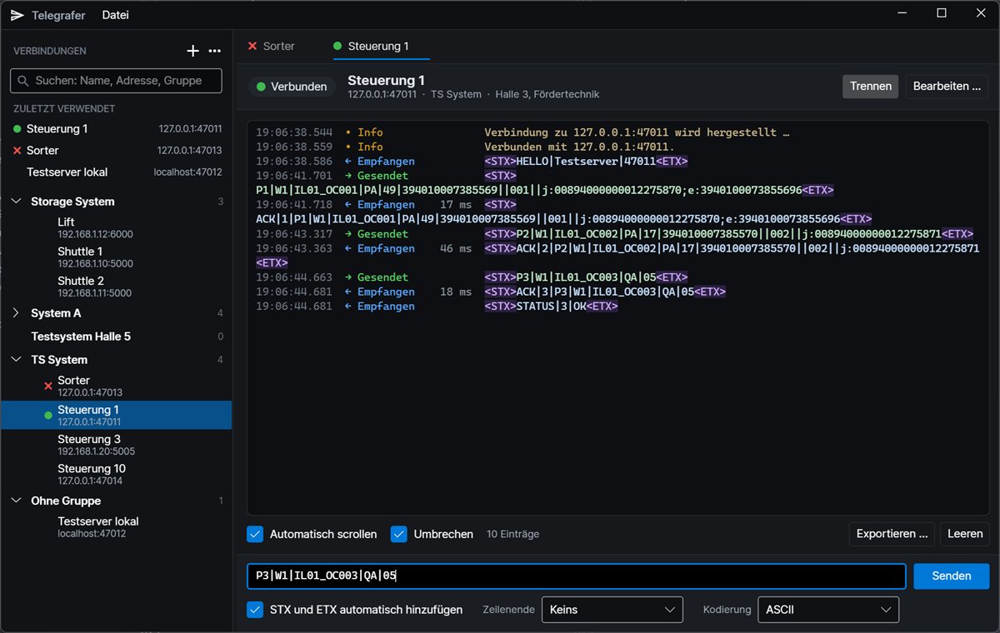

# Telegrafer

TCP-Client für Telegramme: mehrere Verbindungen gleichzeitig in Tabs, gespeicherte Verbindungen in Gruppen und
automatisches Einrahmen der Telegramme mit STX und ETX.



## Funktionen

- **Gespeicherte Verbindungen** mit Name, Host oder IP-Adresse, Port, Beschreibung, Gruppe und eigenen
  Protokolleinstellungen (STX/ETX, Zeilenende, Zeichenkodierung)
- **Gruppen** mit beliebig vielen Verbindungen, unabhängig von der IP-Adresse – z. B. mehrere Ports eines Hosts,
  mehrere Hosts eines Testsystems oder mehrere Anlagen
- Suche über Name, Adresse, Beschreibung und Gruppe; Sortierung nach Name, Adresse oder letzter Verwendung
- „Zuletzt verwendet“ für den schnellen Wechsel, Duplizieren, Verschieben zwischen Gruppen, Import und Export
- mehrere Verbindungen gleichzeitig in Tabs; die geöffneten Tabs werden beim nächsten Start wiederhergestellt
- eindeutige Verbindungszustände mit Symbol, Farbe und Text: getrennt, Verbindung wird hergestellt, verbunden,
  Verbindungsfehler, Verbindung unerwartet beendet
- Telegrammverlauf mit Zeitstempel, Richtung, Antwortzeit und hervorgehobenen Steuerzeichen; Kopieren, Suchen,
  Leeren und Export als CSV (mit den Rohbytes) oder Textdatei

## Was genau gesendet wird

Ein Telegramm wird als `[STX] Inhalt [ETX] [Zeilenende]` auf den TCP-Stream geschrieben:

| Teil | Bytes | Wann |
|---|---|---|
| STX | `0x02` | Option „STX und ETX automatisch hinzufügen“ ist an und der Inhalt beginnt nicht schon mit STX |
| Inhalt | Eingabe nach Auflösung der Escape-Sequenzen, Text in der gewählten Kodierung | immer |
| ETX | `0x03` | Option ist an und der Inhalt endet nicht schon mit ETX (CR/LF dahinter werden dabei ignoriert) |
| Zeilenende | keins, `0x0D`, `0x0A` oder `0x0D 0x0A` | wie beim Tab bzw. der Verbindung eingestellt |

Darüber hinaus wird nichts ergänzt – insbesondere kein CR, LF oder Nullbyte. STX und ETX werden nie verdoppelt,
Eingaben mit `<stx>…<etx>` aus früheren Versionen ergeben also dieselben Bytes wie bisher.

Beispiel mit aktivierter Option und ohne Zeilenende – Eingabe:

```text
P1|W1|IL01_OC001|PA|49|394010007385569||001||j:00894000000012275870;e:3940100073855696
```

Gesendet werden 88 Bytes: `02`, die 86 ASCII-Bytes der Eingabe und `03`.

Die Zeichenkodierung ist pro Verbindung wählbar: ASCII (Standard, wie bisher), ISO-8859-1 oder UTF-8. Ein Zeichen,
das die Kodierung nicht darstellen kann (z. B. „ä“ bei ASCII), wird nicht stillschweigend ersetzt; das Telegramm
wird dann mit einer Fehlermeldung nicht gesendet.

### Escape-Sequenzen

| Eingabe | Ergebnis |
|---|---|
| `<STX>`, `<ETX>`, `<CR>`, `<LF>`, `<TAB>`, `<NUL>`, `<ESC>`, `<ACK>`, `<NAK>` … | das jeweilige ASCII-Steuerzeichen (alle Namen von `NUL` bis `US` sowie `DEL`) |
| `<xHH>` | ein Byte mit dem Hexadezimalwert HH, z. B. `<x1B>`; mehrere Bytes: `<x0D0A>` |
| `<uNNN>` | das Unicode-Zeichen mit dem dezimalen Codepunkt NNN in der gewählten Kodierung |
| `<n>`, `<r>`, `<t>`, `<a>`, `<b>`, `<v>`, `<f>` | Kurzformen von LF, CR, TAB, BEL, BS, VT und FF |
| `<<` | das Zeichen `<` |

Groß- und Kleinschreibung spielt keine Rolle. Eine unbekannte oder nicht mit `>` abgeschlossene Escape-Sequenz wird
gemeldet, und es wird nichts gesendet.

## Empfang und Anzeige

TCP überträgt einen Bytestrom ohne Telegrammgrenzen. Telegrafer stellt sie so wieder her:

- STX … ETX ist ein Telegramm, auch wenn es in mehreren Paketen ankommt; mehrere Telegramme in einem Paket werden
  getrennt angezeigt. Ein direkt folgendes CR/LF gehört zum Telegramm.
- Daten außerhalb von STX/ETX werden bis zum nächsten LF oder nach 100 ms ohne weitere Daten angezeigt.
- Ein Telegramm mit STX, aber ohne ETX wird nach 2 s ohne weitere Daten als „unvollständig“ angezeigt.

In der Anzeige erscheinen Steuerzeichen als `<STX>`, `<ETX>` usw. und farblich hervorgehoben; Bytes, die in der
gewählten Kodierung kein darstellbares Zeichen sind, erscheinen als `<xHH>`. Die übertragenen Daten werden dabei
nicht verändert: „In Eingabefeld übernehmen“ ergibt exakt dieselben Bytes, und der CSV-Export enthält zusätzlich
die Rohbytes in hexadezimaler Form. Die Antwortzeit ist die Zeit vom Senden bis zum ersten danach empfangenen
Telegramm.

## Gespeicherte Daten

Im Anwendungsdatenordner (unter Windows `%APPDATA%\Telegrafer`):

| Datei | Inhalt |
|---|---|
| `connections.json` | gespeicherte Verbindungen, Gruppen und Einstellungen; lesbares JSON. Die vorherige Fassung bleibt als `connections.json.bak` erhalten; eine beschädigte Datei wird als `connections.json.defekt-…` gesichert statt überschrieben. |
| `appstate.json` | geöffnete Tabs (wie in früheren Versionen) |
| `old-payloads.dat` | Verlauf der Eingaben (wie in früheren Versionen) |

Beim ersten Start werden die von früheren Versionen gespeicherten Adressen als Verbindungen übernommen.

## Tastenkürzel

| Taste | Aktion |
|---|---|
| Enter | Telegramm senden; im Adressfeld eines Tabs: verbinden |
| Strg+N | neuer Tab für eine Adresse |
| Strg+S | Tab als Verbindung speichern bzw. gespeicherte Verbindung bearbeiten |
| Strg+W | Tab schließen |
| Strg+Tab, Strg+Bild ab | nächster Tab |
| Strg+Umschalt+Tab, Strg+Bild auf | vorheriger Tab |
| Strg+F | im Verlauf suchen bzw. Verbindungen durchsuchen |

## Erstellen

Benötigt wird das .NET 10 SDK.

```powershell
dotnet build src/Telegrafer
dotnet test src/Telegrafer.Tests
```

Veröffentlichen für Windows (für Linux und macOS entsprechend `linux-x64` bzw. `osx-x64`, siehe `build.ps1`):

```powershell
dotnet publish src/Telegrafer -c Release -r win-x64 --self-contained -p:PublishReadyToRun=true -o ./bin/win-x64/
```

Die Anwendung wird bewusst als Ordner und nicht als Single-File veröffentlicht. Die Single-File-Datei ist eine
große, nicht signierte EXE, die ein Virenscanner bei jedem Erststart vollständig prüft; im Ordner bleiben die
signierten .NET-Bibliotheken als eigene Dateien erhalten. Gemessen unter Windows 11 mit Microsoft Defender:

| Veröffentlichung | Erster Start einer neuen Kopie | Wiederholter Start |
|---|---|---|
| .NET 6, Single-File (bis v0.0.16) | 10,5–14,8 s | ≈ 2,1–2,5 s |
| .NET 10, Ordner mit ReadyToRun | 2,8–3,0 s | ≈ 0,8 s |

Ein Start aus einem von OneDrive synchronisierten Ordner dauerte in der Messung zusätzlich etwa 0,45 s.
